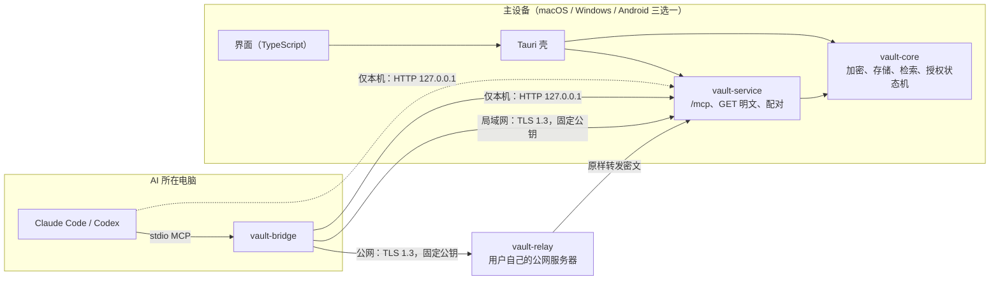
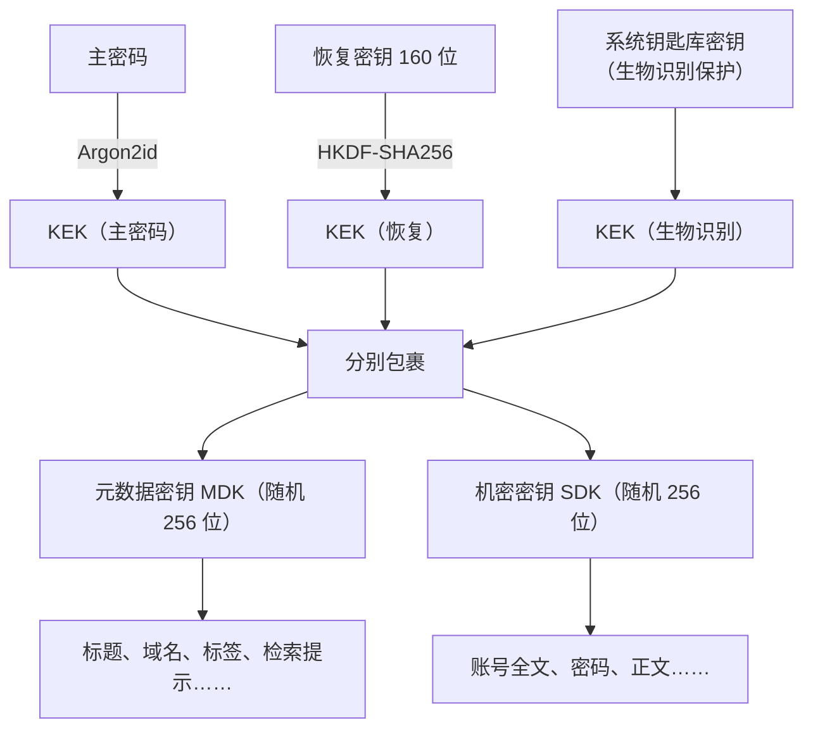
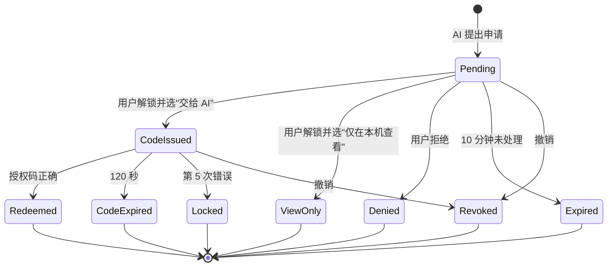

# 随身密库 设计

配套文档：需求与验收编号见 `docs/PRD.md`，威胁分析见 `docs/威胁模型.md`，调研依据见 `docs/调研.md`。

## 1. 总体架构



- `vault-core`：纯逻辑，不含网络和界面。机密只在这里解密。
- `vault-service`：嵌在 App 进程里运行，不是独立守护进程。没有 App 就没有服务。
- `vault-relay`：单个可执行文件，跑在用户的 Linux 服务器上，只转发密文。
- `vault-bridge`：单个可执行文件，跑在 AI 所在电脑上，对 AI 是 stdio MCP 服务器，对设备是 TLS 客户端。
- `apps/client`：Tauri 2 + React + TypeScript。前端不做加解密，不直接联网。

批准动作只存在于界面到 `vault-core` 的进程内调用。**没有任何网络接口、URL scheme、命令行能批准申请。**

## 2. 数据模型

存储用 SQLite（`rusqlite` 内置编译），开启 `secure_delete`。不用 SQLCipher：它需要 OpenSSL，三端交叉编译成本高，而字段级加密已覆盖需求。

### 2.1 表

| 表 | 明文列 | 密文内容 | 加密密钥 |
|---|---|---|---|
| `header` | vault_id、设备状态、纪元、失败次数及时间 | 待核对的迁移完成码 | 元数据密钥 |
| `key_slot` | 槽位、KDF 参数与盐 | 两把独立的数据密钥 | 对应槽位的 KEK |
| `manifest` | 修订号 | 设备状态、纪元、密钥槽与条目摘要 | 元数据密钥 |
| `search_quota` | 客户端 ID | 搜索时间窗口、已返回的不同条目、暂停状态 | 元数据密钥 |
| `item` | item_id（随机 128 位）、rev | 类型、标题、域名、标签、检索提示、打码账号、字段名清单、`ai_hidden`、创建与修改时间、删除时间 | 元数据密钥 |
| `item_field` | item_id、field_id、rev | 单个字段的值 | 机密密钥 |
| `client` | client_id | 令牌的 SHA-256、用户起的名字、可见标签、申请限流及拒绝冷却状态 | 元数据密钥 |
| `audit` | 自增编号 | 时间、client_id、事件、查询指纹、命中或申请条目 ID、字段名、结果 | 元数据密钥 |
| `device` | 无 | 设备 TLS 私钥 | 元数据密钥 |
| `relay` | 无 | 跳板地址、跳板公钥指纹、路由标签 | 元数据密钥 |
| `relay_owner` | 无 | 跳板所有者私钥 | 机密密钥 |

SQLite 页头还保存应用标识与格式版本。条目数量、密文长度和写入顺序可被推知。`device`、`relay`、`relay_owner` 属于后续服务层设计。

### 2.2 条目类型与字段

| 类型 | 元数据 | 机密字段 | AI 可申请的字段名 |
|---|---|---|---|
| `login` 账号 | 标题、域名、标签、检索提示、打码账号 | 账号全文、密码、完整网址、备注、可选 TOTP 种子与自定义字段 | `username` `password` `url` `note` |
| `note` 笔记 | 标题、标签、检索提示 | 正文 | `body` |
| `custom` 自定义 | 标题、域名、标签、检索提示 | 任意多个自定义字段 | `custom`（整组） |

- AI 能申请的字段名由类型固定决定，所以不会泄露某条实际有哪些字段。条目里不存在的字段在交付时省略。
- 打码账号在保存时由账号全文算出并存进元数据，服务运行时不需要机密密钥：邮箱为"首字符 + `***` + `@` + 域名首字符 + `***` + 顶级域"；11 位手机号为"前 3 位 + `***` + 后 2 位"；其他为"首字符 + `***`"；长度小于 4 时为 `***`。星号数量固定。
- 保存时检查元数据中是否混入本条密码或账号全文，混入则拒绝（AC-VLT-08）。

### 2.3 检索

解锁元数据后全部解密进内存，线性扫描。个人密库按 1 万条设计，足够快，磁盘上不留索引。

归一化：NFKC、转小写、去标点。分词：拉丁与数字按词，中日韩按相邻二字。打分按标题、域名、标签、检索提示加权，低于阈值不返回，同分按 item_id 排序保证结果稳定。

AI 搜索与 App 搜索共用算法，差别是：AI 搜索只看元数据、不含回收站与 `ai_hidden`、最多 5 条、有长度与频率限制。App 在完全解锁时另外在内存中匹配账号与正文。

最小长度：归一化后，含中日韩字符的至少 2 个有效字符，其余至少 3 个。中文两字词很常见（如"微信"），所以门槛不同。停用词（如 com、www、账号、密码）不计入有效字符。

## 3. 密钥层级



### 3.1 参数

| 项 | 取值 | 理由 |
|---|---|---|
| KDF | Argon2id，64 MiB，3 次，并行 4，盐 16 字节 | RFC 9106 的第二推荐参数；手机与桌面用同一参数，迁移不必换 |
| KDF 读取限制 | 下限同上；上限 1 GiB、20 次、并行 8 | 防降级，防被篡改的文件耗尽内存 |
| 数据加密 | XChaCha20-Poly1305，随机 24 字节 nonce | 已定方案；随机 nonce 不会撞 |
| 恢复密钥 | 160 位随机，32 个 Crockford 字符加 4 个校验字符，9 组 | 足够长且能手抄；校验能发现抄错 |
| 主密码 | 至少 10 个字符，拒绝内置弱密码表 | 备份文件可被离线猜测 |

MDK 与 SDK 各有独立的包裹密文。任何一种解锁方式都能单独取出其中一把。

### 3.2 AAD

AAD 为带长度前缀的编码：`"suishen-vault/v1"`、用途、vault_id、item_id、field_id、rev。把密文换到别的位置或别的库会解密失败。包裹密文的 AAD 另含格式版本、KDF 参数与盐、包裹槽位，改动头部参数会导致解包失败。

rev 不能防整库回滚：有写权限的人可以用旧文件整个换掉新文件。这是残余风险，写在威胁模型里。

### 3.3 使用的库

`argon2`、`chacha20poly1305`、`hkdf`、`sha2`、`hmac`、`subtle`、`zeroize`、`getrandom`（RustCrypto 与同类，MIT/Apache-2.0）；`ed25519-dalek`（BSD-3-Clause）；`rustls` 配 `ring` 提供者，只开 TLS 1.3；`rcgen` 生成自签证书。选 `ring` 而不是 `aws-lc-rs`，因为 Windows 与 Android 构建不需要额外的 CMake、NASM。

### 3.4 密钥在内存中的状态

| 状态 | MDK | SDK | 允许 |
|---|---|---|---|
| 锁定（服务关） | 无 | 无 | 输入主密码、恢复 |
| 服务中（界面锁定） | 有 | 无 | AI 搜索与申请；界面只显示待批准申请，不能浏览密库 |
| 已解锁 | 有 | 有 | 浏览、编辑、复制 |

- 锁定时清除 SDK；服务关闭且锁定时连 MDK 一起清除。
- 批准一律重新解锁：即使处于"已解锁"，也要再次输入主密码（完整跑一遍 Argon2id）或再次通过生物识别。这次解锁得到的 SDK 只用于解密获批字段，用完即清。
- Android 生物识别：Keystore 密钥要求强生物识别、每次使用都认证、新增生物特征后失效。失效后回退主密码。
- macOS、Windows 的生物识别属于 P1。macOS 的钥匙串生物识别访问控制需要带权限的签名应用，没有签名时不提供该选项，用主密码。实测依据见 [桌面端](桌面端.md)。

### 3.5 机密在内存中的处理

`SecretBytes`/`SecretString` 封装：不实现 `Debug`、`Display`、`Serialize`，离开作用域清零。明文送到前端只用于显示；JavaScript 字符串无法可靠清零，这是残余风险。复制由 Rust 侧直接写剪贴板，不经过前端。

## 4. 首次设置与找回

1. 输入主密码两遍。
2. 生成 vault_id、MDK、SDK、恢复密钥，写入两份包裹。
3. 显示恢复密钥，要求填回随机两组。通过后才提交到磁盘，恢复密钥从内存清除。
4. 用恢复密钥解锁后强制设置新主密码，并生成新恢复密钥，旧的失效。

忘记主密码且丢失恢复密钥，数据无法找回，设置时明确告知。

## 5. 授权状态机



转移表已在 `crates/vault-core/src/grant.rs` 实现并有测试，后续实现必须经由它改状态。

### 5.1 批准时发生的事

1. 用户在批准页核对客户端名、理由、条目、字段，可去掉部分字段。
2. 选择"仅在本机查看"或"交给 AI"，重新解锁。
3. "仅在本机查看"：解密后显示 30 秒，申请进入 `ViewOnly`。
4. "交给 AI"：
   - 生成 40 位随机数，编码为 8 位 Crockford Base32，显示为 `XXXX-XXXX`。
   - 解密获批字段，立即用 `HKDF-SHA256(授权码, 32 字节随机盐)` 得到的密钥重新封装成"一次性包"，AAD 绑定 client_id、request_id、item_id、字段清单、到期时间。随后清除 SDK 与明文。
   - 只保存：一次性包、盐、`HMAC-SHA256(进程随机密钥, 授权码)`、签发时间、错误次数。全部只在内存。

这样即使校验逻辑有缺陷，没有正确的授权码也解不开一次性包。授权码只有 40 位，拿到进程内存的攻击者仍可穷举，所以这只是纵深防御，主要保护来自短有效期和错误次数。

### 5.2 校验规则

- 归一化：去连字符与空格、转大写、`O`→`0`、`I`/`L`→`1`。
- 顺序：客户端令牌 → 申请存在且属于该客户端 → 状态为 `CodeIssued` → 未过期 → 常量时间比较 HMAC → 解一次性包。整个过程持有该申请的锁，成功即先置为 `Redeemed` 再发响应。
- 响应在途中丢失也不能重取，用户需重新批准。宁可多批一次，也不留重放窗口。
- 同一客户端带了 `X-Auth-Code` 且不正确就计一次，格式不对也计。没有带该请求头不计。别的客户端访问返回 404，不计次。
- 到期同时看单调时钟和系统时钟，任一超过 120 秒即过期；系统时钟早于签发时间也视为过期。原因是 macOS 的单调时钟在休眠时不走。

### 5.3 立即失效的情形

关闭或切换开放范围、一键全部关闭、客户端撤销、条目修改/删除/移入回收站/设为对 AI 不可见、开始迁移、App 退出。这些情形下未完成的申请进入 `Revoked`，一次性包清零。App 锁定不影响已签发的授权码，因为一次性包不依赖 SDK。

### 5.4 限流

| 项 | 限制 |
|---|---|
| 搜索 | 每客户端 10 次/分、60 次/时、200 次/天 |
| 枚举 | 每客户端 24 小时内搜到的不同条目超过 30 个即暂停搜索，由用户在 App 恢复 |
| 申请 | 每客户端 3 次/分；待处理每客户端最多 3 个、全局最多 10 个 |
| 拒绝后 | 同客户端同条目 5 分钟内不能再申请；连续 3 次被拒暂停申请 15 分钟 |
| 取明文 | 每客户端 10 次/分 |
| 未认证请求 | 每来源 30 次/分；跳板场景下来源统一为跳板，全局 60 次/分 |

暂停状态与天级计数持久化，重启不清零。

## 6. 接口定义

### 6.1 监听与通用规则

| 开放范围 | 监听 | 传输 |
|---|---|---|
| 关闭 | 无 | 无 |
| 仅本机 | 127.0.0.1:47600、[::1]:47600 | HTTP |
| 局域网 | 上述 + 用户选定网卡的地址:47601 | 上述 HTTP；局域网 TLS 1.3 |
| 公网 | 回环 + 主动外连跳板 | 回环 HTTP；隧道内 TLS 1.3 |

公网档不附带开放局域网，需要的就是最小暴露。端口被占用时报错，不自动换端口，端口可在设置里改。

请求处理顺序：`Host` 校验 → `Origin` 校验 → 路径与方法 → 令牌 → 限流 → 请求体。

- `Host`：回环只接受 `127.0.0.1:端口`、`[::1]:端口`、`localhost:端口`；TLS 只接受设备的路由标签主机名 `<标签>.svault.invalid`。其他返回 421。
- `Origin`：只要出现就返回 403。没有浏览器是合法客户端。rmcp 的来源列表为空时不校验，所以这一层自己实现，放在 rmcp 之前。
- 不发送任何 CORS 头。请求体上限 64 KiB，请求头上限 16 KiB，单连接空闲 60 秒关闭。
- 所有响应带 `Cache-Control: no-store`、`X-Content-Type-Options: nosniff`。

本机服务接受下表中的路径，全部要求 Bearer 令牌。批准、客户端管理、审计查看只接受主窗口进程内调用。

| 方法 | 路径 | 内容 |
|---|---|---|
| GET | `/health` | 只返回 `{"status":"ok"}` |
| POST | `/v1/search` | JSON 请求体含 `query` |
| POST | `/v1/requests` | JSON 请求体含 `item_ref, fields, reason` |
| GET | `/v1/requests/{request_id}` | 自己申请的当前状态 |
| GET | `/v1/requests/{request_id}/secret` | 按 6.6 兑换 |
| POST | `/mcp` | Streamable HTTP |

### 6.2 鉴权

每个客户端一枚 256 位随机令牌，`Authorization: Bearer <令牌>`，设备只存 SHA-256。令牌无效返回 401 与 `WWW-Authenticate: Bearer realm="suishen-vault"`，不带 `resource_metadata`，避免客户端转去走 OAuth。

**不采用 OAuth。** MCP 规范中鉴权对实现是可选的；本服务只服务一个人的几个客户端，令牌在 App 内签发，设备同时当授权服务器只会增加浏览器登录页、令牌端点等攻击面；手机上也没有合适的登录页。Claude Code 与 Codex 都支持静态 Bearer 与由本机命令产生请求头，所以静态令牌两边都能用。代价是与"HTTP 传输应遵循授权规范"这一建议不符，只支持能配置请求头或能运行本机程序的客户端。

令牌的权力有限：只能搜打码信息、提申请。没有用户批准与授权码，令牌换不到明文。

### 6.3 客户端接入

App 在主设备上签发独立令牌。用户可分别存入钥匙串的 Claude 与 Codex 槽位，或在 HTTP 直连模式下通过对应客户端的环境变量提供。配置生成、命令和密钥存放说明见 [本机服务](本机服务.md)。本机版仅监听回环，第 7 节的远程传输属于后续阶段。

### 6.4 远程配对设计（本机版尚未开放）

1. App 点"添加客户端"，填名字，生成一次性配对串 `svp1:...`，内含地址、设备公钥 SHA-256、路由标签、128 位配对密钥。10 分钟有效。
2. 用户在 AI 所在电脑运行 `vault-bridge pair`，在提示处粘贴。不接受命令行参数，以免进 shell 历史。
3. 桥接按固定公钥建立 TLS（回环为 HTTP），`POST /v1/pair` 提交配对密钥与本机名。
4. App 弹出确认，用户确认后服务返回令牌。配对密钥用后即废；错 5 次即废。

### 6.5 MCP

端点 `POST /mcp`。以 2026-07-28 为准，同时接受 2025-11-25：

- 新版：无会话；实现 `server/discover`、`tools/list`、`tools/call`；校验 `MCP-Protocol-Version`、`Mcp-Method`、`Mcp-Name` 与正文一致，不一致返回 400 和 `-32020`；不支持的版本返回 400 和 `-32022`；未知方法返回 404 和 `-32601`。
- 旧版：`initialize` 正常应答但不发 `Mcp-Session-Id`；`GET /mcp`、`DELETE /mcp` 返回 405。
- `tools/list` 的 `ttlMs` 为 3600000，`cacheScope` 为 `private`，顺序固定。
- 不声明 resources、prompts、logging、completions、subscriptions。
- 用官方 `rmcp` 实现协议细节，`legacy_session_mode` 关闭，`json_response` 打开。

跨调用状态用服务器签发的句柄传递：搜索给 `item_ref`，申请给 `request_id`，都绑定客户端。`item_ref` 每次搜索随机生成、30 分钟失效，AI 无法长期积累条目 ID。

两种传输都提供四个工具。

| 工具 | 输入 | 输出 |
|---|---|---|
| `search_entries` | `query` 字符串，最长 100 字 | `results`：至多 5 个 `{item_ref, title, type, domain, masked_account}` |
| `request_access` | `item_ref`；`fields` 1 到 4 个；`reason` 1 到 200 字 | `{request_id, state: "pending", expires_in_seconds, next_step}` |
| `get_request_status` | `request_id`；可选 `wait_seconds` 0 到 20 | `{request_id, state, approved_fields?, expires_in_seconds?}` |
| `get_secret` | `request_id`、`code` | 获批字段，或固定错误 |

状态取值：`pending` `code_issued` `view_only` `denied` `expired` `redeemed` `code_expired` `locked` `revoked`。

`get_request_status` 最多等 20 秒，低于 Codex 默认的 60 秒工具超时。

桥接把 `get_secret` 映射为 6.6 的 GET，授权码写入请求头。HTTP 直连时，工具调用的 `code` 是 MCP 正文参数，适配器在进程内构造同一路径和请求头的 GET。两种传输共用一次性包和消费状态。直连成功时 MCP 工具结果携带获批明文，这一点与普通 GET 响应同样受 `no-store` 保护。

业务错误按工具执行错误返回（`isError: true`），正文为 `{"error":"<代码>","message":"<固定文案>"}`，不回显输入。代码：`query_too_short` `rate_limited` `search_paused` `unknown_item` `invalid_fields` `invalid_reason` `too_many_pending` `cooldown` `unknown_request`。

桥接用 rmcp 处理 stdio 消息，再调用设备端对应的 REST 接口。两端都不记录协议正文，桥接禁用 HTTP 代理和重定向。

### 6.6 GET 明文接口

```
GET /v1/requests/{request_id}/secret
Authorization: Bearer <客户端令牌>
X-Auth-Code: 7K3M-Q9XD
```

成功：

```
200 OK
Content-Type: application/json; charset=utf-8
Cache-Control: no-store

{"request_id":"req_...","item":{"title":"...","type":"login","domain":"..."},
 "fields":[{"name":"password","value":"..."}]}
```

| 情形 | 状态码 | `error` |
|---|---|---|
| 缺少或无效令牌 | 401 | `unauthorized` |
| 申请不存在或属于别的客户端 | 404 | `unknown_request` |
| 还没批准 | 409 | `not_ready` |
| 没有带授权码（不计次） | 400 | `missing_code` |
| 授权码错误（计次） | 403 | `invalid_code` |
| 已用、过期、锁定、撤销、拒绝、仅本机查看 | 410 | `gone`，附 `state` |
| 带任何查询参数 | 400 | `query_not_allowed` |
| 非 GET | 405 | `method_not_allowed` |
| 超限 | 429 | `rate_limited` |

仅 GET 能进入兑换处理器。HEAD、OPTIONS 和带预取标志的请求均在兑换前拒绝。

GET 本应无副作用，这里一次性消耗是用户已定的接口形式；靠禁止缓存、禁止 HEAD、要求两个自定义请求头来避免预取误触。

## 7. 公网跳板

### 7.1 原则

跳板不可信。TLS 在设备上终结，跳板只搬运字节。若让跳板终结 TLS（例如 nginx 反代），它被攻破时会看到令牌、授权码和明文，所以不采用。

也不依赖公开 CA：控制跳板的人同时控制了域名指向的 IP，可以自行申请到该域名的证书。因此桥接只认配对时拿到的设备公钥。

### 7.2 连接

- 控制端口（默认 7443）：设备主动外连，双向 TLS 1.3。设备固定跳板公钥，跳板认设备证书的公钥。连接上跑 `yamux` 多路复用。
- 接入端口（默认 8443）：桥接连入。跳板只读取 TLS ClientHello 中的 SNI，等于当前设备的路由标签（随机 128 位）才接通，否则直接断开。标签不是机密，只用来挡扫描。
- 桥接与设备之间另有一层端到端 TLS 1.3。证书校验：公钥 SHA-256 等于配对值，并且必须照常验证握手签名（自定义校验器常见错误是跳过这一步）。
- 限制：每来源 10 次连接/分、总并发 64、握手 10 秒、空闲 60 秒。

### 7.3 身份与接管

跳板状态文件只有：所有者公钥、纪元、当前设备公钥指纹、路由标签。

| 操作 | 条件 | 结果 |
|---|---|---|
| 认领（首次） | 部署时 `vault-relay init` 输出的一次性认领码，30 分钟有效 | 登记所有者公钥与首个设备，纪元为 1 |
| 连接 | 设备公钥等于当前设备 | 允许；同一设备的新连接替换旧连接 |
| 接管 | 消息由当前所有者私钥签名，内容含跳板公钥、跳板给的随机挑战、新纪元（等于当前加 1）、**新的所有者公钥**、新设备公钥、新标签 | 原子写盘后生效，断开旧设备，旧所有者密钥作废 |
| 重置 | 用户登录服务器运行 `vault-relay reset-owner` | 清空并给出新认领码 |

接管时同时更换所有者密钥，旧设备即使还留着旧密钥也无法再抢回。所有者私钥用机密密钥加密，接管必须先解锁。

跳板若回复"已被取代"，设备只停止公网档并提示用户，不会自动停用或删除密库，防止恶意跳板骗设备自毁。

残余：持有迁移前备份和主密码的人若抢先接管，会先一步生效；用户可登录服务器重置。

### 7.4 部署

单个静态链接可执行文件，普通用户运行，附 systemd 单元示例。两个端口都在 1024 以上。不需要域名和证书。是否部署、部署到哪台服务器由用户决定并操作。

## 8. 三选一与迁移

### 8.1 主设备

密库文件所在且状态为 `active` 的设备就是主设备。设备状态：`active`、`migrating`（只读、服务关闭）、`retired`（只能清除）。密库打开时持有文件锁，防止同机双开。

### 8.2 迁移流程

1. 旧设备：设置 → 迁移到新设备，重新解锁。一键关闭服务，状态改为 `migrating`。
2. 生成迁移码：130 位随机加 2 位校验，共 28 个字符、7 组，只显示一次。
3. 写出迁移包 `.svmig`：数据库快照（去掉客户端、设备私钥、限流状态），用 `HKDF-SHA256(迁移码, 盐)` 的密钥整体再加密一层。条目本身仍是原来的密文。
4. 用户自行把文件拷到新设备。导入需要迁移码，以及主密码或恢复密钥。用恢复密钥找回访问权时须另行设置新主密码并核对新恢复密钥。
5. 新设备逐条解密校验，数量与摘要一致后写入，生成新设备密钥；若配置了跳板，用所有者密钥接管。
6. 新设备显示 8 位完成码（由迁移码派生的 HMAC 截断）。用户在旧设备输入，旧设备状态改为 `retired`，提示清除。
7. 清除：删除密库文件、WAL、钥匙串项、生物识别密钥。闪存上无法保证物理擦除，但文件本身是密文。

未输入完成码前，旧设备可取消迁移恢复使用，此时提示：若新设备其实已导入成功，会出现两份密库。

### 8.3 迁移后要做的事

客户端令牌和设备身份不迁移，AI 客户端要重新配对。这样旧设备上的令牌立刻没有用处。

### 8.4 备份

`.svbak` 是数据库的一致性快照，与本机文件同等加密，另含整体校验。用主密码或恢复密钥打开。恢复到新设备视作接管。

### 8.5 做不到的事（必须告知用户）

没有中心服务器，无法阻止用户或他人复制 `.svbak`、`.svmig`（连同迁移码）或密库文件到另一台设备同时使用，也无法让已复制出去的副本失效。改主密码对旧副本无效，旧副本仍可用旧主密码打开。旧设备的停用状态是本机标记，改过的程序可以绕过。唯一有强制力的是公网跳板：它只认一个当前设备。

## 9. 平台要点

| 项 | macOS | Windows | Android |
|---|---|---|---|
| 数据目录 | 应用数据目录，权限 0600 | 用户应用数据目录 | 应用私有目录，关闭系统备份 |
| 防截屏 | 窗口内容保护 | 窗口内容保护 | FLAG_SECURE |
| 剪贴板标记 | `org.nspasteboard.ConcealedType` | `ExcludeClipboardContentFromMonitorProcessing` | `EXTRA_IS_SENSITIVE` |
| 生物识别 | P1，需签名 | P1 | P0 |
| 自动锁定触发 | 闲置、锁屏、休眠 | 同左 | 闲置、熄屏、切到后台 |
| 服务存活 | App 运行期间 | App 运行期间 | 前台服务加常驻通知；划掉 App 即关 |

Android 最低 API 29，目标架构 arm64-v8a 与 x86_64（模拟器）。前台服务类型用 `specialUse`，因为 `dataSync` 类型在新系统上有运行时长限制，而本应用由用户自行安装、不走应用商店审核。

前端：严格 CSP，不加载远程内容，不内联脚本；窗口逐条授予本应用自己的命令，不开放 Tauri 内置的文件、命令行、HTTP 能力；发布版关闭开发者工具。

日志：统一经白名单日志层，只允许事件名、计数、状态、错误代码。代码库用 lint 禁止 `println!`、`dbg!`。App 与桥接的 panic 钩子丢弃正文。不集成任何远程崩溃上报与统计。

## 10. 有歧义处的默认选择

| 问题 | 选择 | 理由 |
|---|---|---|
| "AI 能凭授权码取明文"是 MCP 工具还是 HTTP | 两种传输提供 get_secret，按 6.6 兑换 | 在 REST 与 MCP 之间共享同一次批准和消费记录 |
| 一次申请几个字段 | 同一条目的一到四个字段 | 登录通常同时要账号和密码，逐个批准会加重授权疲劳 |
| 搜索 ID 是否固定 | 每次搜索随机 | 防止 AI 长期积累索引，也防止跨客户端关联 |
| 公网是否含局域网 | 不含 | 最小暴露 |
| 自动关闭默认值 | 仅本机 8 小时；局域网与公网 1 小时 | 越开放越短 |
| 锁定后服务是否继续 | 继续，只用元数据密钥 | 已定方案；否则手机锁屏后 AI 就无法申请 |
| 是否支持 claude.ai 网页版、Codex 云端 | 第一版不支持 | 它们不能运行本机程序，只能用公开 CA 证书的 HTTPS，跳板被攻破时可被中间人截获 |
| AI 理由里的内容 | 当作不可信纯文本，去控制字符，标明来源 | 防提示注入影响用户判断 |
| 批准是否可"记住" | 不提供 | 已定方案要求每次授权 |
| 迁移是否重新加密全部数据 | 不重加密 | 旧副本无论如何都有旧数据，重加密只增加出错面 |
| iOS | 不做 | 用户列出的三端不含 iOS，本机也没有 Xcode |
| 前端框架 | React 19 + Vite | 生态成熟，壳层薄，后续任务容易接手 |
| 项目许可证 | 暂不授予开源许可 | 由用户决定是否公开；在此之前按私有项目处理 |

## 11. 代码结构与任务边界

| 目录 | 职责 | 允许依赖 |
|---|---|---|
| `crates/vault-core` | 加密、存储、检索、授权、迁移 | 无网络、无 Tauri |
| `crates/vault-service` | HTTP、MCP、TLS、配对、限流、跳板客户端 | vault-core |
| `crates/vault-relay` | 跳板服务器 | 不依赖 vault-core，避免服务器上带有密库代码 |
| `crates/vault-bridge` | AI 侧桥接 | vault-core 仅用常量与编码 |
| `apps/client` | 界面与 Tauri 壳 | vault-core、vault-service |

常量集中在 `crates/vault-core/src/policy.rs`，开放范围在 `scope.rs`，授权状态在 `grant.rs`。
